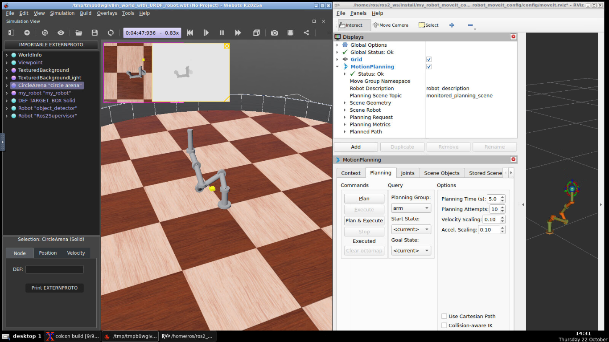
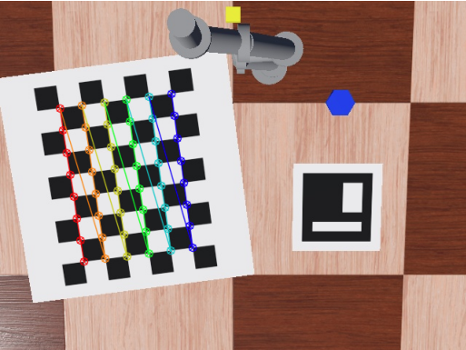
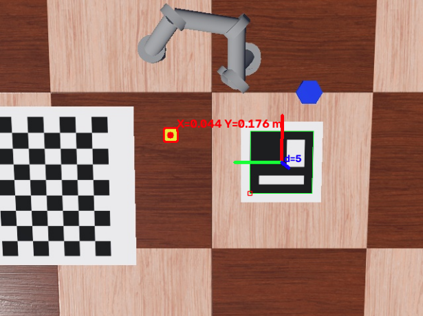
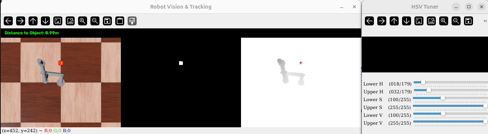

# Webots Simulation with ROS 2 in a Docker Container

This repository contains Docker container with a Webots simulation of robot running with ROS 2 and MoveIt for motion planning.

[](./images/simulation.png)

## Docker Containter

First you need to build the container located in the [./docker/](./docker/). Then you will have the simulation environment.

The initial build will take a while. Please be patient.

Useful Docker commands:
```bash
# build containers
docker compose build
docker compose up -d     # create it again (no rebuild needed)
docker compose down      # stop and remove the container

# run containers
docker compose start     # start the same container again
docker compose stop      # stop, keeps the container
docker compose restart   # both in one step

# connect to terminal of the container
docker exec -it ros2-jazzy-webots bash

# clean the Docker files 
docker system prune
docker system prune -a --volumes
docker builder prune -a
docker image prune -a
```

## Webots Simulation

You can start the simulation with the following steps:

1. Open noVNC in the browser:
    `http://localhost:6080/?autoconnect=true&resize=scale`

2. Within the browser terminal execute:
    ```bash
    cd ros2_ws
    . run.sh
    ```

If you want to modify the world of the simulation you can do it in the following way:

1. Open noVNC in the browser:
    `http://localhost:6080/?autoconnect=true&resize=scale`

2. Within the browser terminal execute: `webots`

3. Open the world file `~/ros2_ws/src/webots_simulation/worlds/my_world.wbt`

4. Modify the world

5. Save the modified file

*Note: If the simulation works slow, you can disable the rendering from the Webots interface from the menu `View -> Rendering`.*

## Example Python Scripts

You can take a look at the example Python scripts located in the [./examples/](./examples/) folder. Run them in a separate virtual environment outside of the Docker container.

The scripts are as follows:

- [./examples/send_waypoints.py](./examples/send_waypoints.py) contains an example of how to send commands to the robot using the API;

- [./examples/track_object.py](./examples/track_object.py) shows how to read the simulated camera RGB stream or real USB camera from OpenCV and to filter the image by a specific color;

- [./examples/track_object_with_depth.py](./examples/track_object_with_depth.py) shows how to read both the simulated RGB and the depth video streams and how to locate an object;

- [./examples/scene_api_demo.py](./examples/scene_api_demo.py) shows how to manipulate the scene with the provided API;

- [./examples/scene_ros_demo.py](./examples/scene_ros_demo.py) shows how to manipulate the scene from ROS 2 nodes;

- [./examples/pick_and_place_demo.py](./examples/pick_and_place_demo.py) contains sample script which maniplates the scene and executes pick and place operation;

- [./examples/helpers.ipynb](./examples/helpers.ipynb) is a Jupyter notebook with useful scripts for creation of images like chessboard pattern or ArUco markers which can be used as a textures for objects in the Webots simulation;

- [./examples/webots_camera_calibration.ipynb](./examples/webots_camera_calibration.ipynb) is a Jupyter notebook which uses the API to move the chessboard pattern in the camera view to capture images for camera calibration;

  [](./images/webots_camera_calibration.png)

- [./examples/webots_pick_and_place.ipynb](./examples/webots_pick_and_place.ipynb) is a Jupyter notebook which demostrates how the planar position of the yellow object can be found, picked and placed when an ArUco marker is placed in the workspace.

  [](./images/webots_pick_and_place.png)

[](./images/tracking_example.png)

*Note: If you have problems with the fonts for the trackbar labels you can try the following:*
```bash
# Install fonts
sudo apt-get update
sudo apt-get install libfontconfig1 fonts-dejavu
# Create the missing fonts directory inside your virtual environment
mkdir -p <path-to-venv>/lib/python3.12/site-packages/cv2/qt/fonts

# Copy the DejaVu fonts into it
cp /usr/share/fonts/truetype/dejavu/* <path-to-venv>/lib/python3.12/site-packages/cv2/qt/fonts/
```
*Other approach is to downgrade the version of the OpenCV:* `pip install "opencv-python<4.13"`.

## Services in the Container

The Docker container provided the following services:
- noVNC at 127.0.0.1:6080;
- camera streams from ROS 2 topics at 127.0.0.1:9090;
- robot API at 127.0.0.1:8001;
- scene manipulator API at 127.0.0.1:8002.

*Note: If you have connected to a remote server you might need to manually forward the ports to your computer. This can be done from the Visual Studio Code interface.*

## ROS 2 Apps

RViz is not started automatically. If you need RViz with MoveIt interface you can launch it with: `ros2 launch my_robot_moveit_config moveit_rviz.launch.py`.
